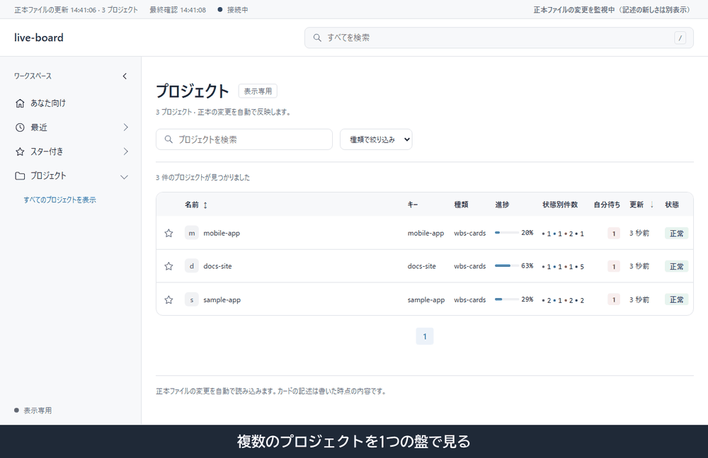

[English](README.md) | [日本語](README.ja.md)

# live-board

live-boardは、プロジェクトのバックログやWBSのJSONを読む、ローカル専用の進捗盤です。すでに管理している正本ファイルを監視し、変更をブラウザーへ自動で反映します。画面の文言は日本語です。



## 表示するもの

- 概要・タイムライン・バックログ・ボード・一覧・リリースの各画面と、プロジェクト一覧。
- 正本ファイルを1秒ごとに確認し、SSEで変更を通知する自動更新。
- 読込失敗時に保持した最後の正常な内容と、正本の経過時間・確認遅延や切断の警告・検証エラー。
- カードの記述が変わっていない時間と、進行中カードの最も古い記述の経過時間。時間だけでは警告しません。
- プロジェクトをまたぐ「あなた向け」画面で、進行中の課題と自分待ちの課題。
- 任意のファイル数による進捗と、実行中ジョブからの通知。
- 認証済みの `gh` による任意のGitHub PR・CI状態と、課題との食い違いやCI失敗の警告。

## 仕組み

Pythonサーバーが `127.0.0.1` だけで待ち受け、画面をブラウザーへ配信します。`winsmux-backlog` はローカルの `build_py` モジュールでYAMLを読み、`wbs-cards` は `cards` と `done_hidden` を持つschema 1のWBS JSONを読みます。

WBSの状態は `p-run`（進行中）、`p-hold`（未着手）、`p-wait`（待ち）、`p-owner`（自分待ち）です。古い `p-sora` も警告付きで `p-owner` として受け付け、未知の値は警告付きで未着手と表示します。
完了時はカードを `cards` から外し、`done_hidden` を増やします。`status: "done"` は使えません。

カードの記述履歴は、絶対パスへ解決した設定ファイルの隣の `tmp/card-history.json` に保存し、再起動後も残ります。プラグイン利用時は `${CLAUDE_PLUGIN_DATA}/tmp/card-history.json` に保存し、プラグイン更新後も残ります。`--history PATH` で保存先を変えられます。

## 導入

Python 3.13以降、サーバーを起動するPython環境のPyYAML、ブラウザーが必要です。PyYAMLがなければ、その環境で `python -m pip install pyyaml` を実行してください。

```sh
claude plugin marketplace add Sora-bluesky/live-board
claude plugin install live-board@live-board
```

## 使い方

Claude Codeにlive-boardを開くよう依頼します。[スキル](skills/live-board/SKILL.md)は `${CLAUDE_PLUGIN_DATA}/projects.json` に設定を置き、なければ同梱サンプルをコピーして実際の絶対パスを確認します。このフォルダーはプラグイン更新後も残ります。`${CLAUDE_PLUGIN_DATA}` はスキル本文で置換する値で、シェル環境変数ではありません。

cloneから手動で起動する場合は、リポジトリのルートで実行します。

```sh
python -c "import shutil; shutil.copyfile('projects.example.json', 'projects.local.json')"
```

サンプルのパスを置き換え、使わないプロジェクトを削除してから起動します。

```sh
python skills/live-board/scripts/server.py --config projects.local.json --port 8795
```

ブラウザーで<http://127.0.0.1:8795/>を開き、終了は `Ctrl+C`。`--config` は必ず指定してください。`projects.local.json` はGit対象外です。

## 設定

[projects.example.json](projects.example.json)の最上位に `projects` 配列を置きます。各項目のキーは次のとおりです。

| キー | 意味 |
| --- | --- |
| `id` | 重複しないプロジェクト識別子。 |
| `name` | 表示名。 |
| `adapter` | `winsmux-backlog` または `wbs-cards`。 |
| `source` | バックログのYAMLまたはWBS JSONの絶対パス。 |
| `build_py` | 信頼するローカルPythonモジュールの絶対パス。`winsmux-backlog` では必須。 |
| `github_repo` | 任意。PR状態を取得するGitHubリポジトリを `owner/name` 形式で指定。 |
| `activity_dir` | 任意。ジョブの実行状況ファイルを置くフォルダーの絶対パス。両アダプターに対応。 |

`winsmux-backlog` でPR状態を表示するには、`gh` を認証し、`github_repo` を設定してYAMLの課題に `pr: 6` または `pr: [6, 7]` を加えます。非公開の設定や実行状況ファイルをコミットしないでください。

## カードの書き方

- 題（WBSの `text`、winsmux-backlogの `title`）は作業の名前だけを40字以内で書きます。字数はPythonの `len` で数え、経緯・数値・PRは `note` に移します。
- WBSの `label` は12字以内の短いバッジです。文章は `note` に書きます。
- WBSの `status` に書く値は、`p-run`（進行中）、`p-hold`（未着手）、`p-wait`（待ち）、`p-owner`（自分待ち）の4つの文字列だけです。
- 旧形式の `p-sora` と `ball: true` は意味を保ったまま警告します。代わりに `status: "p-owner"` と書いてください。`ball` は省略でき、省略時は `false` です。指定する場合は真偽値にします。
- WBSのカードのキーは `code`, `section`, `text`, `note`, `status`, `label`, `ball`, `progress`、最上位のキーは `schema`, `lane`, `repo`, `handoff`, `generated_at`, `done_hidden`, `cards` です。それ以外には、ボードに表示されないため内容を `note` に移すよう警告します。

書き方の警告があってもカードは読み込めます。WBS検査CLIと任意のフックも同じ警告を報告し、`check_wbs.py` は警告が1つでもあると終了1になります。

## 任意のWBS検査フック

cloneのルートで `python skills/live-board/scripts/tools/check_wbs.py /absolute/path/to/wbs.json` を実行できます。正常なら終了0、エラーや警告なら終了1です。WBSだけの検査にはPyYAMLは不要です。
任意のClaude Code用 `PostToolUse` フックは `skills/live-board/scripts/tools/wbs_hook.py` です。既存の `wbs.json` を検査し、問題をClaudeへ返します。
自動登録はしません。使いたい場合はスキルに登録手順を尋ねてください。

## 行わないこと

正本ファイルや課題の状態は書き換えず、課題管理ツールの代わりにもなりません。盤自身の記述履歴は別に保存します。任意の `gh` によるGitHubへの読取要求以外に外部送信はなく、認証情報も `gh` が管理します。

live-boardは一人で使うマシンを想定しています。ほかの人もログインするマシンでは、そのアカウントから盤の表示内容を読み取れるため、非公開プロジェクトを扱う場合は実行しないでください。

`build_py` はサーバープロセスの権限でローカルのPythonコードを実行します。信頼するファイルだけを指定してください。そのスクリプトを隔離する仕組みはありません。

## 開発

JavaScriptのテストにはNode.js 24を使います。リポジトリのルートで実行してください。

```sh
python -m unittest discover -s tests -t .
node tests/test_app.cjs
node tests/test_app.cjs layout
```

3つ目は任意で、PlaywrightとChromiumが必要です。既存のものを使う場合は `PLAYWRIGHT_MODULE` と `PLAYWRIGHT_CHROMIUM_EXECUTABLE_PATH` で指定できます。テストはローカルのフィクスチャと偽の `gh` を使い、GitHubへ接続しません。

## ライセンス

MIT。[LICENSE](LICENSE)を参照してください。
