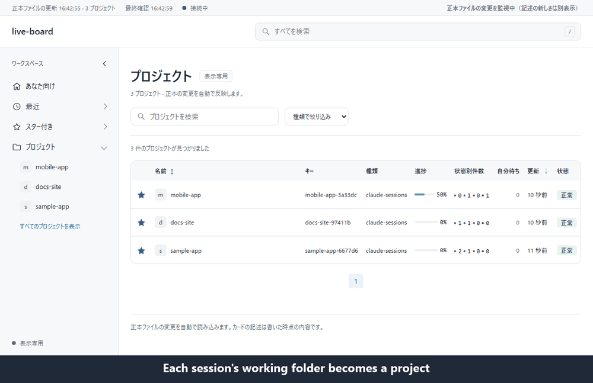

[English](README.md) | [日本語](README.ja.md)

# live-board

live-board is a local progress board for people who run several Claude Code sessions on different projects at once.

When each session works on its own project, it takes effort to check across conversations how far each one has got and which ones wait for your decision. Copying the tasks into a separate tracker is extra work.

live-board records the task list of each Claude Code session through the plugin's hooks and shows every working folder as a project on one board in the browser pane next to the chat in the Claude Code desktop app. The board follows within about a second, and one view lists the tasks waiting for you across all projects, including sessions that are asking you a question. You can also add the backlog (YAML) and WBS (`wbs.json`) files you already keep. The records stay on your machine and are not sent anywhere. Any browser can open it too. The UI is in Japanese.



## What it shows

- Overview, timeline, backlog, board, list and release views, plus a project directory.
- Live updates through server-sent events (SSE), checking source files every second.
- Last good data on read errors, with source age, stale/connection warnings and validation errors.
- Card description age and the oldest in-progress description; age alone does not trigger a warning.
- A cross-project personal view with in-progress tasks and tasks waiting for the owner.
- Optional file-count progress and activity reported by running jobs.
- Optional GitHub PR/CI status through authenticated `gh`, with status mismatches and failing CI warnings.

## How it works

The plugin's hooks record each session in `${CLAUDE_PLUGIN_DATA}/sessions`: the task list from the desktop app's plan tool or the CLI task tools, the first 120 characters of the latest prompt, and whether the session is asking you a question. In the CLI, the newest models have no task list tool, so those sessions show only their latest prompt. The `claude-sessions` adapter turns the records into one project per working folder.

A Python server listens only on `127.0.0.1` and serves the browser UI. The `winsmux-backlog` adapter reads YAML using a local `build_py` module; `wbs-cards` reads schema 1 WBS JSON with `cards` and `done_hidden`.

WBS states are `p-run` (in progress), `p-hold` (not started), `p-wait` (waiting) and `p-owner` (waiting for the owner). Legacy `p-sora` is accepted as `p-owner` with a warning; unknown values display as not started with a warning.
Complete a WBS card by removing it from `cards` and incrementing `done_hidden`; `status: "done"` is unsupported.

Card description history is saved in `tmp/card-history.json` next to the resolved config file and survives restarts. Plugin use keeps it at `${CLAUDE_PLUGIN_DATA}/tmp/card-history.json`, which also survives plugin updates. Use `--history PATH` to override the location.

## Install

You need Python 3.13+, PyYAML in the server's Python environment, and a browser. If PyYAML is missing, run `python -m pip install pyyaml` in that environment.

```sh
claude plugin marketplace add Sora-bluesky/live-board
claude plugin install live-board@live-board
```

## Use

Ask Claude Code to open and manage the board:

- "Open live-board."
- "Add the project at C:/work/alpha with its .claude/local/wbs/wbs.json to the board."
- "Remove the configured project alpha from the board."
- "Hide the automatic folder C:/work/alpha from the board."

The plugin records Claude Code sessions automatically and shows one board project per recorded working folder (the Git root inside a repository). Tasks from sessions in the same folder share that project; no config editing is needed.

The [skill](skills/live-board/SKILL.md) creates `${CLAUDE_PLUGIN_DATA}/projects.json` with a session source if missing, and manages additional sources and hidden folders there. For a config from v0.1.0, the skill asks before adding the session source if it is missing. This folder survives plugin updates; `${CLAUDE_PLUGIN_DATA}` is a skill-body substitution, not a shell environment variable. Config changes need a board restart; Claude restarts a board it started and checks `/healthz`.

### Manual setup

To start manually from a clone, run from the repository root:

```sh
python -c "import shutil; shutil.copyfile('projects.example.json', 'projects.local.json')"
```

Replace the example paths and remove unused projects, then start:

```sh
python skills/live-board/scripts/server.py --config projects.local.json --port 8795
```

Open <http://127.0.0.1:8795/>. Stop with `Ctrl+C`. Always pass `--config`; `projects.local.json` is ignored by Git.

## Configuration

[projects.example.json](projects.example.json) has a top-level `projects` array. Each entry uses these keys:

| Key | Meaning |
| --- | --- |
| `id` | Unique project identifier. |
| `name` | Display name. |
| `adapter` | `winsmux-backlog`, `wbs-cards` or `claude-sessions`. |
| `source` | Absolute path to the YAML backlog, WBS JSON or sessions folder. |
| `hidden` | Optional array of absolute folder paths to hide; `claude-sessions` only. Paths use the same normalization as session grouping (case-insensitive on Windows). |
| `build_py` | Absolute path to a trusted local Python module; required by `winsmux-backlog`. |
| `github_repo` | Optional GitHub repository in `owner/name` form for PR status. |
| `activity_dir` | Optional absolute path to a folder of job activity files; supported by `winsmux-backlog` and `wbs-cards`. |

For PR status on `winsmux-backlog`, authenticate `gh`, set `github_repo`, and add `pr: 6` or `pr: [6, 7]` to YAML tasks. Keep private configs and activity files out of commits.

## Writing cards

- Keep the title (`text` in WBS, `title` in winsmux-backlog) to the work's name, within 40 characters as counted by Python `len`. Put background, numbers and PR references in `note`.
- Keep WBS `label` to a short badge of 12 characters or fewer; put sentences in `note`.
- Write WBS `status` as exactly one of these four strings: `p-run` (in progress), `p-hold` (not started), `p-wait` (waiting), `p-owner` (waiting for the owner).
- Legacy `p-sora` and `ball: true` keep their meaning but warn; write `status: "p-owner"` instead. `ball` is optional and defaults to `false`; when present, it must be a boolean.
- WBS card keys are `code`, `section`, `text`, `note`, `status`, `label`, `ball`, `progress`; top-level keys are `schema`, `lane`, `repo`, `handoff`, `generated_at`, `done_hidden`, `cards`. Other keys warn that their content belongs in `note` because the board does not show them.

These writing warnings still allow the card to load. The WBS checker and optional hook report them too; `check_wbs.py` exits 1 on any warning.

## Optional WBS check hook

Validate a WBS file with `python skills/live-board/scripts/tools/check_wbs.py /absolute/path/to/wbs.json` from the clone root. It exits with 0 on success and 1 on errors or warnings; WBS-only validation needs no PyYAML.
The optional Claude Code `PostToolUse` hook is `skills/live-board/scripts/tools/wbs_hook.py`. It checks existing files named `wbs.json` and reports problems to Claude.
It is not registered automatically. Ask the skill for registration instructions if you want it.

## What it does not do

It never writes source files or changes task status, and does not replace a task tracker. Its own card history is written separately. No data is sent externally except optional GitHub reads through `gh`; credentials stay with `gh`.

live-board is meant for single-user machines. While the board runs, other local accounts can read what it shows, including recorded prompt beginnings and task names, so do not run it on shared machines with private projects. Common token and password shapes are masked before saving, but other sensitive text is not, so do not paste secrets at the start of a prompt on shared machines.

`build_py` executes local Python code with the server process's permissions. Use only trusted files; the board does not sandbox that script.

## Development

Use Node.js 24 for JavaScript tests. Run from the repository root:

```sh
python -m unittest discover -s tests -t .
node tests/test_app.cjs
node tests/test_app.cjs layout
```

The third command is optional and needs Playwright and Chromium. Existing installations can be selected with `PLAYWRIGHT_MODULE` and `PLAYWRIGHT_CHROMIUM_EXECUTABLE_PATH`. Tests use local fixtures and a fake `gh`, without contacting GitHub.

## License

MIT. See [LICENSE](LICENSE).
